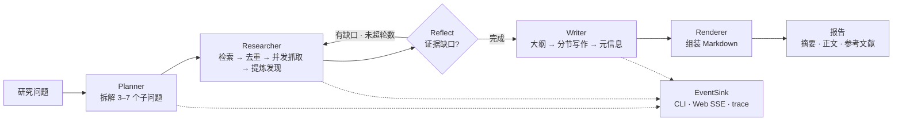

<p align="center">
  
</p>

<p align="center">
  <a href="README_EN.md">English</a> · <b>简体中文</b>
</p>

<p align="center">
  <a href="https://github.com/qiebai233/deepresearch/actions/workflows/ci.yml"></a>
  <a href="https://www.python.org/downloads/"></a>
  <a href="LICENSE"></a>
  <a href="pyproject.toml"></a>
  <a href="https://github.com/qiebai233/deepresearch/releases"></a>
</p>

> **AI 深度调研助手**：输入一个研究问题，Agent 自动完成检索、阅读、交叉验证、写作，输出带引用的研究报告。

**30 秒离线体验**（不需要任何 API key，不联网）：

```bash
git clone https://github.com/qiebai233/deepresearch.git
cd deepresearch
pip install -e .

deepresearch run "固态电池 2025 产业化进展与主要瓶颈" --demo
```

不想安装？在仓库根目录直接运行：

```bash
PYTHONPATH=src python -m deepresearch run "固态电池 2025 产业化进展与主要瓶颈" --demo
```

> Windows PowerShell：`$env:PYTHONPATH = "src"; python -m deepresearch run "..." --demo`

运行结束后，报告落在 `reports/<时间>-<问题>/report.md`，同目录还有 `result.json`（结构化数据）
与 `trace.jsonl`（事件轨迹）。`--demo` 用的是确定性 mock 数据，**只用于体验流程**；
接下来填一个 key 就能做真实调研。

```text
reports/20261026-164611-固态电池-2025-产业化进展与主要瓶颈/
├── report.md      # 摘要 / 关键发现 / 目录 / 分节正文 / 研究方法与局限 / 参考文献
├── result.json    # 报告 + 研究状态 + 用量统计
└── trace.jsonl    # 逐行事件，便于调试与复现
```

## 特性

- **完整的研究闭环**：Planner 拆解问题 → 多轮检索 → 并发抓取正文 → 提炼带引用的发现 →
  Reflect 识别证据缺口并补检 → 生成大纲 → 分节写作 → 渲染 Markdown 报告。
- **引用可核查**：正文中的 `[S1]` 与参考文献一一对应，只保留真正抓取并被引用的来源；
  无效引用在渲染前剔除，空章节也能正常渲染。
- **两个入口，一套内核**：CLI（`deepresearch run/serve/...`）与本地 Web UI 调用同一个
  `run_research()`，行为与产物完全一致。
- **任意 OpenAI 兼容模型**：DeepSeek / OpenAI / OpenRouter / Ollama / vLLM / 自建网关，
  也可完全离线使用内置 mock。
- **四种搜索后端**：Tavily、自建 SearXNG、`none`（纯模型知识）、`mock`（离线）。
- **成本与时间可控**：`quick` / `standard` / `deep` 三档深度，
  外加 `--max-sources` / `--max-cost` / `--max-seconds` 预算保护，超限时软停止并写入报告局限。
- **零第三方运行时依赖**：只用 Python 标准库（HTTP、HTML 解析、Web 服务、并发、测试），
  `pip install` 没有依赖树，审计与部署成本极低。
- **全链路可观测**：统一事件流同时驱动终端进度、Web SSE 和 `trace.jsonl`。
- **开箱即用的工程配置**：GitHub Actions CI（3.10–3.13 lint + 测试 + 构建）、
  tag 触发的 Release、Dockerfile / Compose、一键发行脚本。

## 工作原理



深度决定预算：`quick` 3 子问题 / 8 来源 / 1 轮反思，`standard` 5 / 14 / 2，`deep` 7 / 24 / 3。
详细的模块边界、数据模型、事件与扩展点见 **[docs/architecture.md](docs/architecture.md)**。

## 安装

需要 Python **3.10+**。运行时没有任何第三方依赖。

| 方式 | 命令 | 适用场景 |
| --- | --- | --- |
| pip（推荐） | `pip install -e .` | 日常使用，获得 `deepresearch` 命令 |
| 免安装 | `PYTHONPATH=src python -m deepresearch ...` | 试用、不想改动环境 |
| Docker | `docker build -t deepresearch:0.1.0 .` | 隔离部署 |
| 源码 + 测试 | `python run_tests.py` | 开发与贡献 |

```bash
# 从 GitHub 安装
git clone https://github.com/qiebai233/deepresearch.git
cd deepresearch
pip install .

deepresearch version
```

## 配置（最快路径）

默认配置即可离线运行。要接真实模型，只需填一个 key：

```bash
cp .env.example .env              # Windows: Copy-Item .env.example .env
```

编辑 `.env`，取消注释并填入 [DeepSeek](https://platform.deepseek.com) 的 key：

```dotenv
DEEPSEEK_API_KEY=sk-...
```

想要外部引用与参考文献，再填一个 [Tavily](https://tavily.com) key：

```dotenv
TAVILY_API_KEY=tvly-...
```

然后确认配置已被识别：

```bash
deepresearch providers
```

```text
  当前配置
  LLM provider          deepseek
  LLM model             deepseek-chat
  LLM endpoint          https://api.deepseek.com/v1
  API key               set
  Search provider       tavily
  ...
```

- provider 会**根据你填的 key 自动识别**，不需要手工设置 `DEEPRESEARCH_LLM_PROVIDER`。
- 配置优先级：CLI 参数 > 环境变量 > `.env` > 默认值。
- 全部环境变量、预设与费用估算见 **[docs/configuration.md](docs/configuration.md)**；
  各服务商（OpenAI / OpenRouter / Ollama / vLLM / SearXNG）的接入步骤见
  **[docs/providers.md](docs/providers.md)**。
- `deepresearch init` 可以生成另一份 `.env` 模板（预填 DeepSeek + Tavily 占位值，
  需要替换后才能联网）。

## CLI 用法

```text
deepresearch run "问题" [options]    运行一次深度调研
deepresearch serve [options]         启动本地 Web UI
deepresearch providers               查看当前配置与可用 provider
deepresearch init                    生成 .env 配置模板
deepresearch version                 版本与环境信息
deepresearch --version               只打印版本号
```

全局参数 `--env-file PATH` 用于指定 `.env` 文件，**必须写在子命令之前**：

```bash
deepresearch --env-file .env.prod run "问题"
```

### `deepresearch run` 参数

| 参数 | 说明 |
| --- | --- |
| `--depth quick\|standard\|deep` | 调研深度，默认 `standard` |
| `--lang zh\|en` | 报告语言，默认中文 |
| `--provider mock\|deepseek\|openai\|openrouter\|ollama\|custom` | LLM 提供方 |
| `--model NAME` | 模型名，如 `deepseek-chat`、`gpt-4o-mini` |
| `--base-url URL` | 自定义 OpenAI 兼容端点 |
| `--search tavily\|searxng\|none\|mock` | 搜索后端 |
| `--out DIR` | 报告输出目录，默认 `reports/` |
| `--max-sources N` | 来源数量上限（覆盖深度预设） |
| `--max-cost USD` | 预估费用预算上限，`0` = 不限 |
| `--max-seconds SEC` | 墙钟时间预算上限，`0` = 不限 |
| `--no-json` / `--no-trace` | 不写 `result.json` / `trace.jsonl` |
| `--no-save` | 不落盘，只返回结果 |
| `--stdout` | 只把 Markdown 打印到标准输出（适合管道） |
| `--quiet`, `-q` | 隐藏实时进度，只留最终摘要 |
| `--demo` | 离线演示：mock LLM + mock 搜索 + mock 抓取 |
| `--debug` | 出错时打印完整 traceback |

### 常用示例

```bash
# 离线演示（零配置）
deepresearch run "量子计算最新进展" --demo

# 真实调研：标准深度
deepresearch run "中国新能源汽车出海面临的主要挑战" --depth standard

# 深度报告 + 英文输出
deepresearch run "What are the main bottlenecks of solid-state batteries?" --depth deep --lang en

# 只用模型知识、不联网（无外部引用）
deepresearch run "解释一下 RAG 的典型架构" --search none

# 预算保护
deepresearch run "某行业趋势" --max-cost 0.10 --max-seconds 300 --max-sources 10

# 管道：只要 Markdown
deepresearch run "问题" --demo --stdout > report.md

# 换配置文件
deepresearch --env-file .env.prod run "问题"

# 列出可用 provider 与当前配置
deepresearch providers
```

## Web UI

```bash
deepresearch serve --open      # 默认 http://127.0.0.1:8000，--open 自动打开浏览器
```

界面布局示意（原生 HTML/CSS/JS，无 CDN、无构建步骤，深浅色自适应，中英切换）：

```text
┌──────────────────────────────────────────────────────────────┐
│  DeepResearch                                    [中/EN]     │
├──────────────────────────────────────────────────────────────┤
│  研究问题                                                     │
│  ┌────────────────────────────────────────────────────────┐  │
│  │ 输入一个问题…                                          │  │
│  └────────────────────────────────────────────────────────┘  │
│  深度 [ quick | standard | deep ]        [ 开始调研 ]         │
│  示例：固态电池 / GLP-1 / AI Act / 核聚变…                   │
├───────────────────────────┬──────────────────────────────────┤
│  实时进度（SSE）           │  报告                            │
│  10% ◈ 已生成研究计划       │  # 标题                          │
│  35% ⌕ 检索「…」           │  ## 摘要 …                       │
│  60% ✓ 已抓取 6 个来源      │  ## 关键发现 …                   │
│  …                        │  ## 参考文献 [S1] [S2] …         │
│                           │  [下载 .md] [下载 .json] [复制]  │
└───────────────────────────┴──────────────────────────────────┘
```

- 输入问题、选择深度即可开始；进度通过 Server-Sent Events 实时推送，无需轮询。
- 报告区支持基础 Markdown 渲染（标题/段落/列表/引用角标/链接/代码），并对内容做 HTML 转义。
- 可下载 `report.md` / `result.json`、一键复制；内存中保留最近 20 次运行。
- 服务只依赖标准库，默认仅监听 `127.0.0.1`：**没有鉴权，请勿直接暴露到公网**。
- 健康检查：`curl http://127.0.0.1:8000/api/health`。
- Docker：`docker compose up --build`（报告与缓存通过卷持久化）。

> 截图将在发布时补充到 `assets/`（当前仓库只包含自绘 banner，不含任何虚构截图）。

## 报告长什么样

报告结构固定，便于批处理与二次加工：

```markdown
# {标题}
> **研究问题**：{问题}
> *生成时间 / 模型 / 深度 / 来源数*

## 摘要
...
## 关键发现
- ... [S1][S3]
## 正文（目录）
1. [章节一](#...) / 2. ...
## {章节标题}
... [S1][S3]
## 研究方法与局限
...
## 参考文献
1. [S1] {标题} — {url}
---
*由 DeepResearch v0.1.0 生成 · 内容由 AI 汇总，请核实关键数据*
```

完整示例见 **[examples/sample_report.md](examples/sample_report.md)**（由离线 mock 运行生成），
可直接复制使用的研究问题见 **[examples/sample_questions.md](examples/sample_questions.md)**。

> 报告由模型汇总生成，可能存在错误或过时信息；参考文献只覆盖真正被引用的来源，
> 关键结论请回到原文核实。

## 项目结构

```text
deepresearch/
├── src/deepresearch/
│   ├── cli.py / __main__.py   # 命令行入口
│   ├── api.py                 # run_research() 顶层接口
│   ├── config.py              # 配置、预设、校验、费用估算
│   ├── models.py              # 数据模型
│   ├── events.py              # 事件流
│   ├── errors.py / http.py / console.py / storage.py
│   ├── llm/                   # LLM provider（OpenAI 兼容 + mock）
│   ├── search/                # 搜索 provider（Tavily/SearXNG/none/mock）
│   ├── fetch/                 # 抓取、正文抽取、缓存
│   ├── agent/                 # 规划/调研/反思/写作编排
│   ├── report/                # Markdown 渲染
│   └── server/                # 标准库 Web 服务 + 静态前端
├── tests/                     # 全部离线：本地 stdlib HTTP 服务 + mock
├── docs/                      # 架构 / 配置 / provider / 快速开始 / FAQ / 发布
├── examples/                  # 示例报告与问题清单
├── assets/                    # banner 等静态图
├── scripts/                   # 一键发行脚本（publish.ps1 / publish.sh）
├── .github/                   # CI、Release、Issue/PR 模板、Dependabot
├── Dockerfile / docker-compose.yml / Makefile
└── pyproject.toml
```

## 路线图

`v0.1.0` 是首个公开版本（Beta）。以下方向按需推进，**不承诺时间**：

- [x] 五阶段研究流水线 + 引用可核查的 Markdown 报告
- [x] CLI 与 Web UI 双入口、离线 mock、预算保护、事件轨迹
- [x] CI（3.10–3.13）、tag 自动 Release、Docker、一键发行脚本
- [ ] 报告导出 PDF / DOCX（当前可用 `pandoc` 等外部工具转换）
- [ ] 更多搜索后端与更强的正文解析（当前为 Tavily / SearXNG / none / mock）
- [ ] 可选的持久化与多用户会话（当前 Web UI 仅在内存保留最近 20 次运行）
- [ ] 更细粒度的成本报告与运行对比

## 常见问题

安装失败、配置不生效、费用、质量、部署等常见问题见 **[docs/faq.md](docs/faq.md)**。
入门步骤见 **[docs/quickstart.md](docs/quickstart.md)**。

## 贡献

欢迎 issue 与 PR！请先阅读 **[CONTRIBUTING.md](CONTRIBUTING.md)** 与
**[CODE_OF_CONDUCT.md](CODE_OF_CONDUCT.md)**。

两条硬性边界：**运行时零第三方依赖**（只用 Python 标准库）、**测试禁止真实联网**。

```bash
python run_tests.py        # 全量测试（免安装）
ruff check src tests       # 代码规范
```

安全漏洞请按 **[SECURITY.md](SECURITY.md)** 私下报告，不要公开 issue。

## 许可证

本项目以 [MIT License](LICENSE) 发布 © 2026 DeepResearch Contributors。

---

<p align="center">
  <sub>如果这个项目对你有帮助，欢迎点一个 ⭐ Star。</sub>
</p>
