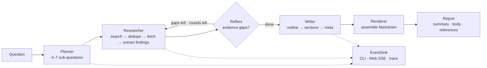

<p align="center">
  
</p>

<p align="center">
  <b>English</b> · <a href="README.md">简体中文</a>
</p>

<p align="center">
  <a href="https://github.com/qiebai233/ai-deep-research-assistant/actions/workflows/ci.yml"></a>
  <a href="https://www.python.org/downloads/"></a>
  <a href="LICENSE"></a>
  <a href="pyproject.toml"></a>
  <a href="https://github.com/qiebai233/ai-deep-research-assistant/releases"></a>
</p>

> **AI deep-research assistant**: ask one question and an agent searches, reads, cross-checks and
> writes a research report with real citations — no API key needed for the offline demo.

**30-second offline demo** (no API key, no network):

```bash
git clone https://github.com/qiebai233/ai-deep-research-assistant.git
cd deepresearch
pip install -e .

deepresearch run "Main bottlenecks of solid-state batteries in 2025" --demo
```

Prefer not to install anything? Run it straight from the repository:

```bash
PYTHONPATH=src python -m deepresearch run "Main bottlenecks of solid-state batteries in 2025" --demo
```

> Windows PowerShell: `$env:PYTHONPATH = "src"; python -m deepresearch run "..." --demo`

Each run creates `reports/<timestamp>-<question-slug>/` containing `report.md` (the deliverable),
`result.json` (structured record) and `trace.jsonl` (event trace). `--demo` uses deterministic
mock data — it exercises the full pipeline but is **not real research**. Add a key to research for real.

```text
reports/20261026-164611-solid-state-batteries-2025/
├── report.md      # summary / key findings / TOC / sections / method & limitations / references
├── result.json    # report + research state + usage stats
└── trace.jsonl    # one JSON event per line (debug / replay)
```

## Features

- **Full research loop**: Planner decomposes the question → multi-round search → concurrent page
  fetching → cited findings → Reflect finds evidence gaps and issues follow-up queries → outline →
  section-by-section writing → Markdown rendering.
- **Verifiable citations**: in-text `[S1]` markers map one-to-one to references; only sources that
  were actually fetched and cited survive, invalid citations are dropped before rendering.
- **Two front ends, one core**: the CLI (`deepresearch run/serve/...`) and the local Web UI both call
  the same `run_research()`, so behaviour and artefacts are identical.
- **Any OpenAI-compatible model**: DeepSeek / OpenAI / OpenRouter / Ollama / vLLM / self-hosted
  gateways, plus a fully offline deterministic mock.
- **Four search backends**: Tavily, self-hosted SearXNG, `none` (model knowledge only) and `mock`.
- **Cost and time control**: `quick` / `standard` / `deep` depth profiles plus
  `--max-sources` / `--max-cost` / `--max-seconds` budgets; when a budget is hit the run stops
  gracefully and records the reason under "limitations".
- **Zero third-party runtime dependencies**: standard library only (HTTP, HTML parsing, web server,
  threading, unittest). Nothing to audit in the dependency tree, and `pip install` is instant.
- **Observable end-to-end**: one event stream drives terminal progress, Web SSE and `trace.jsonl`.
- **Release-ready engineering**: GitHub Actions CI (3.10–3.13 lint + tests + build), tag-triggered
  releases, Dockerfile/Compose, one-command publish scripts.

## How it works



Depth profiles: `quick` = 3 sub-questions / 8 sources / 1 reflection round, `standard` = 5 / 14 / 2,
`deep` = 7 / 24 / 3. Module boundaries, data models, events and extension points are documented in
**[docs/architecture.md](docs/architecture.md)**.

## Install

Requires Python **3.10+**. No runtime dependencies.

| Method | Command | When |
| --- | --- | --- |
| pip (recommended) | `pip install -e .` | daily use, installs the `deepresearch` command |
| No install | `PYTHONPATH=src python -m deepresearch ...` | try it without touching your environment |
| Docker | `docker build -t deepresearch:0.1.0 .` | isolated deployment |
| Source + tests | `python run_tests.py` | development and contributions |

```bash
git clone https://github.com/qiebai233/ai-deep-research-assistant.git
cd deepresearch
pip install .

deepresearch version
```

## Configuration (fastest path)

The defaults already run offline. For real research, fill in one key:

```bash
cp .env.example .env              # Windows: Copy-Item .env.example .env
```

Edit `.env` and set a [DeepSeek](https://platform.deepseek.com) key:

```dotenv
DEEPSEEK_API_KEY=sk-...
```

To get external citations and a references section, also add a [Tavily](https://tavily.com) key:

```dotenv
TAVILY_API_KEY=tvly-...
```

Verify the resolved configuration:

```bash
deepresearch providers
```

```text
  LLM provider          deepseek
  LLM model             deepseek-chat
  LLM endpoint          https://api.deepseek.com/v1
  API key               set
  Search provider       tavily
  ...
```

- The provider is **auto-detected from the key you provide** — no need to set
  `DEEPRESEARCH_LLM_PROVIDER` manually.
- Precedence: CLI flags > environment variables > `.env` file > built-in defaults.
- Every environment variable, preset and the cost model: **[docs/configuration.md](docs/configuration.md)**.
  Provider setup (OpenAI / OpenRouter / Ollama / vLLM / SearXNG): **[docs/providers.md](docs/providers.md)**.
- `deepresearch init` generates another `.env` template (pre-filled with DeepSeek + Tavily
  placeholders — replace them before running online).

## CLI

```text
deepresearch run "question" [options]    run one deep-research session
deepresearch serve [options]             start the local web UI
deepresearch providers                   show current config and available providers
deepresearch init                        generate a .env template
deepresearch version                     version and environment info
deepresearch --version                   print just the version
```

The global `--env-file PATH` flag selects a `.env` file and **must come before the subcommand**:

```bash
deepresearch --env-file .env.prod run "question"
```

### `deepresearch run` options

| Flag | Description |
| --- | --- |
| `--depth quick\|standard\|deep` | research depth, default `standard` |
| `--lang zh\|en` | report language, default Chinese |
| `--provider mock\|deepseek\|openai\|openrouter\|ollama\|custom` | LLM provider |
| `--model NAME` | model name, e.g. `deepseek-chat`, `gpt-4o-mini` |
| `--base-url URL` | custom OpenAI-compatible endpoint |
| `--search tavily\|searxng\|none\|mock` | search backend |
| `--out DIR` | output directory, default `reports/` |
| `--max-sources N` | hard cap on sources (overrides the depth profile) |
| `--max-cost USD` | estimated cost budget; `0` = unlimited |
| `--max-seconds SEC` | wall-clock budget; `0` = unlimited |
| `--no-json` / `--no-trace` | skip `result.json` / `trace.jsonl` |
| `--no-save` | do not write artefacts |
| `--stdout` | print Markdown only (pipe-friendly) |
| `--quiet`, `-q` | hide live progress, keep the final summary |
| `--demo` | offline demo: mock LLM + mock search + mock fetcher |
| `--debug` | print the full traceback on errors |

### Examples

```bash
# offline demo, zero config
deepresearch run "Recent progress in quantum computing" --demo

# real research at standard depth
deepresearch run "Main challenges for Chinese EV makers going global" --depth standard

# deep, English report
deepresearch run "What are the main bottlenecks of solid-state batteries?" --depth deep --lang en

# model knowledge only (no web search, no external citations)
deepresearch run "Explain the typical architecture of RAG" --search none

# budget guards
deepresearch run "Industry outlook" --max-cost 0.10 --max-seconds 300 --max-sources 10

# pipe the Markdown somewhere
deepresearch run "question" --demo --stdout > report.md

# alternate config file
deepresearch --env-file .env.prod run "question"

# inspect providers
deepresearch providers
```

## Web UI

```bash
deepresearch serve --open      # http://127.0.0.1:8000, --open opens the browser
```

Layout sketch (native HTML/CSS/JS, no CDN, no build step, dark/light aware, zh/en toggle):

```text
┌──────────────────────────────────────────────────────────────┐
│  DeepResearch                                    [中/EN]     │
├──────────────────────────────────────────────────────────────┤
│  Research question                                           │
│  ┌────────────────────────────────────────────────────────┐  │
│  │ Ask anything…                                          │  │
│  └────────────────────────────────────────────────────────┘  │
│  Depth [ quick | standard | deep ]        [ Start research ] │
│  Examples: solid-state batteries / GLP-1 / AI Act / fusion…  │
├───────────────────────────┬──────────────────────────────────┤
│  Live progress (SSE)      │  Report                          │
│  10% ◈ plan ready         │  # Title                         │
│  35% ⌕ searching "…"      │  ## Summary …                    │
│  60% ✓ 6 sources fetched  │  ## Key findings …               │
│  …                        │  ## References [S1] [S2] …       │
│                           │  [.md] [.json] [copy]            │
└───────────────────────────┴──────────────────────────────────┘
```

- Type a question, pick a depth, start; progress streams over Server-Sent Events.
- The report pane renders basic Markdown (headings, paragraphs, lists, bold, code, links) with
  HTML escaping.
- Download `report.md` / `result.json`, copy to clipboard; the last 20 runs stay in memory.
- Standard library only; binds to `127.0.0.1` by default. **There is no authentication — do not
  expose it to the public internet.**
- Health check: `curl http://127.0.0.1:8000/api/health`.
- Docker: `docker compose up --build` (reports and cache are persisted through volumes).

> A screenshot will be added to `assets/` at release time; the repository currently ships only the
> self-drawn banner and no fabricated screenshots.

## What the report looks like

```markdown
# {title}
> **Research question**: {question}
> *generated at / model / depth / sources*

## Summary
...
## Key findings
- ... [S1][S3]
## Contents
1. [Section one](#...) / 2. ...
## {section heading}
... [S1][S3]
## Method and limitations
...
## References
1. [S1] {title} — {url}
---
*Generated by DeepResearch v0.1.0 · AI-generated content, verify key facts*
```

A full example: **[examples/sample_report.md](examples/sample_report.md)** (produced by the offline
mock). Ready-to-use research questions: **[examples/sample_questions.md](examples/sample_questions.md)**.

> Reports are model-generated and may contain errors or outdated information. Only cited sources
> appear in the references — verify key claims against the originals.

## Project layout

```text
deepresearch/
├── src/deepresearch/
│   ├── cli.py / __main__.py   # command-line entry point
│   ├── api.py                 # run_research() facade
│   ├── config.py              # settings, presets, validation, cost model
│   ├── models.py              # data models
│   ├── events.py              # event stream
│   ├── errors.py / http.py / console.py / storage.py
│   ├── llm/                   # LLM providers (OpenAI-compatible + mock)
│   ├── search/                # search providers (Tavily/SearXNG/none/mock)
│   ├── fetch/                 # fetching, text extraction, cache
│   ├── agent/                 # plan / research / reflect / write pipeline
│   ├── report/                # Markdown rendering
│   └── server/                # stdlib web server + static front end
├── tests/                     # fully offline: local stdlib HTTP servers + mocks
├── docs/                      # architecture / configuration / providers / quickstart / FAQ / publishing
├── examples/                  # sample report + question list
├── assets/                    # banner and other static images
├── scripts/                   # one-command publish scripts (publish.ps1 / publish.sh)
├── .github/                   # CI, release workflow, issue/PR templates, Dependabot
├── Dockerfile / docker-compose.yml / Makefile
└── pyproject.toml
```

## Roadmap

`v0.1.0` is the first public release (Beta). These are directions, **not commitments with dates**:

- [x] five-stage research pipeline with verifiable citations
- [x] CLI + Web UI, offline mock, budget guards, event trace
- [x] CI (3.10–3.13), tag-triggered releases, Docker, one-command publishing
- [ ] PDF / DOCX export (today: convert with `pandoc` or similar)
- [ ] more search backends and better article extraction (currently Tavily / SearXNG / none / mock)
- [ ] optional persistence and multi-user sessions (the Web UI keeps the last 20 runs in memory)
- [ ] finer-grained cost reporting and run comparisons

## FAQ

See **[docs/faq.md](docs/faq.md)** for installation, configuration, cost, quality and deployment
questions. New here? Read **[docs/quickstart.md](docs/quickstart.md)**.

## Contributing

Issues and PRs are welcome. Please read **[CONTRIBUTING.md](CONTRIBUTING.md)** and
**[CODE_OF_CONDUCT.md](CODE_OF_CONDUCT.md)** first.

Two hard rules: **zero third-party runtime dependencies** (standard library only) and
**tests never touch the network**.

```bash
python run_tests.py        # full suite, no install needed
ruff check src tests       # style
```

Please report security issues privately as described in **[SECURITY.md](SECURITY.md)**.

## License

Released under the [MIT License](LICENSE) © 2026 DeepResearch Contributors.

---

<p align="center">
  <sub>If this project helps you, please consider giving it a ⭐.</sub>
</p>
