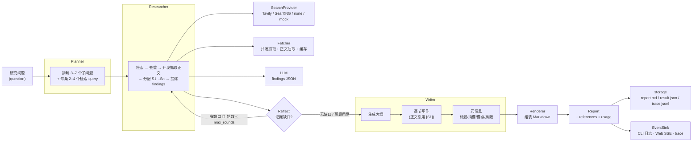
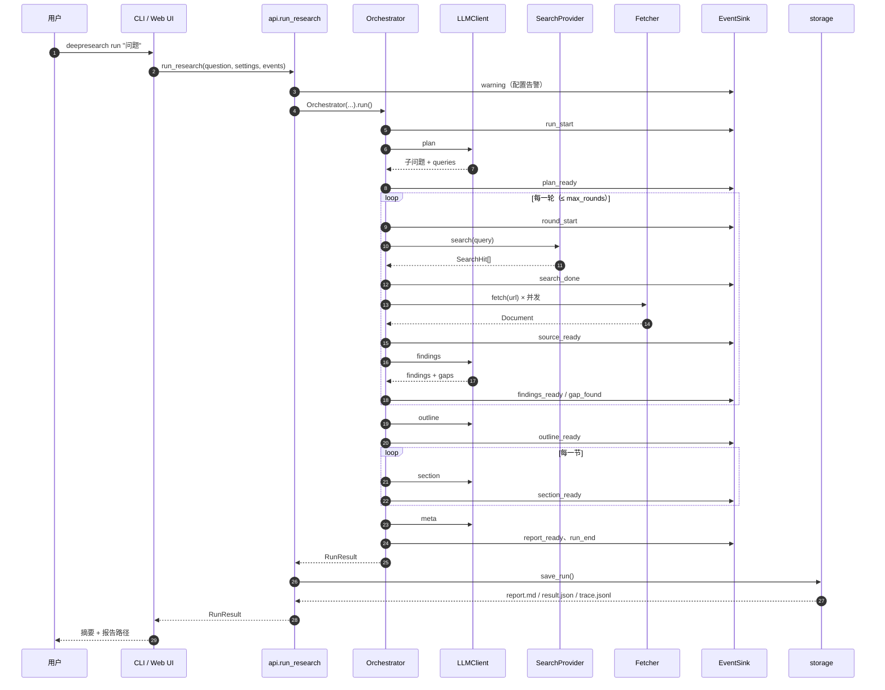
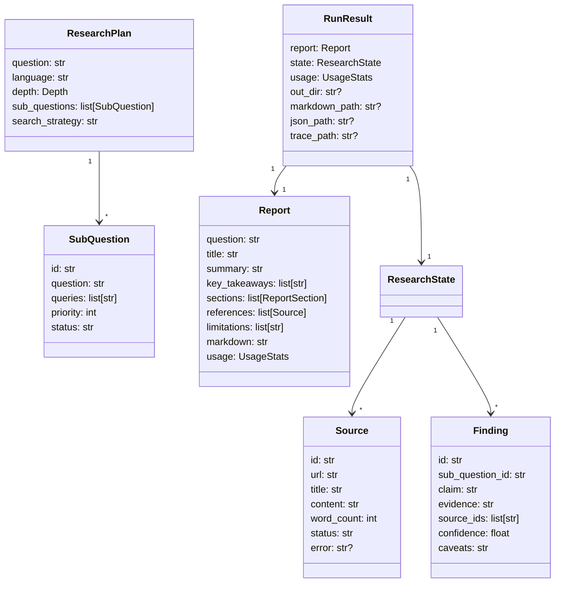

# 架构

本文说明 DeepResearch 的端到端数据流、模块边界、事件与预算机制，以及可扩展点。
所有实现只依赖 **Python 3.10+ 标准库**，没有 Web 框架、没有 HTTP 第三方库、没有 ORM。

- 面向使用者的安装与配置：[quickstart.md](quickstart.md)、[configuration.md](configuration.md)
- Provider 接入细节：[providers.md](providers.md)

## 1. 设计目标

| 目标 | 具体做法 |
| --- | --- |
| 零第三方运行时依赖 | `urllib`（HTTP）、`html.parser`（正文抽取）、`http.server`（Web UI）、`threading`（并发抓取 / 后台任务）、`unittest`（测试） |
| 开箱即用 | 默认配置在无任何 key 时以 mock 模式跑通全流程，产出确定性报告 |
| 全链路可观测 | 单一事件流（`events.py`）同时驱动 CLI 实时日志、Web SSE 与 `trace.jsonl` |
| 结果可核查 | 正文引用 `[S1]` 必须对应真实抓取来源；报告附带参考文献、方法与局限 |
| 成本可控 | 深度预设 + 三个预算上限（调用数 / 费用 / 墙钟时间）+ 网页缓存 |
| 双入口一致 | CLI 与 Web 都调用同一个 `api.run_research()`，行为与产物完全相同 |

## 2. 端到端数据流

一次运行的顺序（与事件流一一对应）：

1. **Planner**：把问题拆成 3–7 个子问题（含优先级、检索 query），并给出整体检索策略。
2. **Researcher**：对每条 query 检索 → 按 URL 去重 → 并发抓取正文（默认 4 并发）→ 截断到
   `fetch_max_chars` → 分配来源编号 `S1…Sn` → 让模型抽取带证据的发现（claim / evidence /
   source_ids / confidence / caveats）。
3. **Reflect**：检查哪些子问题证据不足，生成补检 query 并再次检索；轮数由深度预设决定
   （quick 1 轮 / standard 2 轮 / deep 3 轮）。
4. **Writer**：生成大纲与元信息（标题、摘要、关键要点、局限），再逐节写作；正文引用只能使用
   已存在的来源编号。
5. **Render**：按固定结构组装 Markdown（摘要 → 关键发现 → 目录 → 分节正文 → 研究方法与局限 →
   参考文献 → 免责声明），只保留**被正文引用**的来源并重新编号。
6. **Storage**：写入 `reports/<时间>-<问题 slug>/` 下的三个产物。

## 3. 调用时序

> 模型调用使用同步 HTTP（`http.HttpClient`），抓取用线程池并发；整条流水线是**同步阻塞**的，
> 没有 asyncio。Web 端把 `run_research` 放进后台线程，用 SSE 把事件转发给浏览器。

## 4. 模块边界

| 模块 | 职责 | 对外关键接口 |
| --- | --- | --- |
| `models.py` | 数据模型：`ResearchPlan`、`Source`、`Finding`、`Gap`、`OutlineItem`、`Report`、`UsageStats`、`RunResult`、`DepthProfile` | 数据类 + `profile_for(depth)` |
| `events.py` | 事件类型与订阅分发 | `EventType`、`ProgressEvent`、`EventSink.emit()` |
| `errors.py` | 异常层级 | `DeepResearchError` → `ConfigError` / `ProviderError` / `BudgetExceeded` / `ReportError`；`http.HttpError` |
| `http.py` | **唯一出站 HTTP 出口**：重试（429/5xx/网络错误）、gzip、charset 解码、大小与超时限制 | `HttpClient.get/post_json`、`HttpResponse` |
| `config.py` | 配置解析、provider 预设、校验、费用估算 | `Settings.from_env()`、`.validate()`、`.profile()`、`.estimate_cost()` |
| `console.py` | 终端着色、表格、事件渲染（`NO_COLOR` / 非 TTY 自动降级） | `Console` |
| `storage.py` | 运行产物落盘与 slug 化目录命名 | `save_run()`、`run_directory()` |
| `api.py` | 顶层门面：解析配置、订阅事件、调用编排、落盘 | `run_research(question, …) -> RunResult` |
| `llm/` | LLM provider：OpenAI 兼容实现 + 确定性 mock | `build_llm(settings)`、`LLMClient` 协议 |
| `search/` | 搜索 provider：Tavily / SearXNG / none / mock | `build_search(settings)`、`SearchProvider` 协议 |
| `fetch/` | 抓取、HTML 正文抽取、文件缓存 | `build_fetcher(settings)`、`Fetcher` 协议、`extract_main_text()` |
| `agent/` | 流水线编排（Planner / Researcher / Writer），负责预算与容错 | `Orchestrator(settings, …).run(question)` |
| `report/` | Markdown 渲染与引用排序 | `render_markdown(report)`、`citation_order(report)` |
| `server/` | 标准库 Web 服务 + 静态单页应用 | `create_server()`、`serve()` |
| `cli.py` / `__main__.py` | 命令行入口（`deepresearch` / `python -m deepresearch`） | `main(argv)` |

三条重要纪律：

- **出站请求只走 `http.HttpClient`**：统一重试、超时、UA、大小限制与错误映射，便于审计与测试。
- **库代码不打印**：内部只用 `EventSink` 发事件，`Console` 只在 CLI 层使用。
- **引用必须真实**：正文里的 `[S\d+]` 只能指向已抓取来源；无效引用在渲染前被剔除。

## 5. 数据模型

`ResearchState` 是运行期的工作区：`plan`、`sources`（URL → `Source`）、`findings`、`gaps`、
`outline`、`iteration` 与 `usage`。`Report` 是最终交付物，`RunResult` 把报告、状态、产物路径打包返回。

## 6. 事件流与进度

事件类型固定为：

`run_start` → `plan_ready` → (`round_start` → `search_start` → `search_done` → `fetch_start` →
`source_ready` → `findings_ready` → `gap_found`)\* → `outline_ready` → `section_ready`\* →
`report_ready` → `run_end`，另有 `warning` / `error`。

- 每个事件带 `type`、`message`（中文；`--lang en` 时英文）、`data`、`percent`（0–100 单调不减）、
  `at`（UTC 时间戳）。
- CLI 实时渲染为带符号与百分比的一行；Web UI 以 SSE 逐条推送；`trace.jsonl` 逐行记录完整事件。
- 事件订阅失败不会中断研究：`EventSink.emit` 捕获监听器异常。

## 7. 预算、缓存与容错

### 7.1 深度预设

| depth | 子问题上限 | 每问题 query | 来源上限 | 反思轮数 | finding 上限 | 每节目标词数 |
| --- | --- | --- | --- | --- | --- | --- |
| `quick` | 3 | 2 | 8 | 1 | 6 | 180 |
| `standard` | 5 | 3 | 14 | 2 | 14 | 320 |
| `deep` | 7 | 4 | 24 | 3 | 24 | 550 |

### 7.2 三层保护

- `profile.max_sources`：**硬上限**，超过的来源不再进入语料。
- `max_llm_calls` / `max_cost_usd` / `max_seconds`：**软预算**，超限后停止后续 LLM 调用，
  用已有材料完成报告，并把原因写入 `Report.limitations`（正常返回，不抛异常）。
- 费用按 `config.MODEL_PRICING` 的近似价目表与 token 用量估算；未知模型记为 0。

### 7.3 缓存

抓取结果写入 `cache_dir`（默认 `.deepresearch/cache`），文件名是 URL 的 SHA-1，TTL 由
`cache_ttl_hours` 控制（默认 24 小时）；`use_cache=false` 或 `cache_ttl_hours<=0` 时禁用。
缓存不是研究结果缓存：**LLM 输出不会被缓存**。

### 7.4 失败降级

| 失败点 | 行为 |
| --- | --- |
| 单条搜索 query 报错 | 记 `warning`，该 query 返回空结果，其余继续 |
| 单个网页抓取失败（4xx/5xx/超时/非 HTML） | 该来源标记 `failed`，不进入语料，不影响其他来源 |
| LLM 返回非法 JSON | 追加「只返回 JSON」提示重试一次；仍失败则用确定性启发式兜底继续 |
| 引用不存在的来源 | 渲染前剔除无效引用 |
| 预算超限 | 软停止并写入局限 |
| 配置缺失（无 key / 无端点） | 启动前抛 `ConfigError`，CLI 返回码 2 并给出修复提示 |

## 8. Web 服务

`deepresearch serve` 使用 `ThreadingHTTPServer` 提供静态页面与 JSON API，默认绑定
`127.0.0.1:8000`（无鉴权，仅本机访问）。

| 路由 | 方法 | 说明 |
| --- | --- | --- |
| `/` | GET | 单页应用 `index.html` |
| `/static/<file>` | GET | 静态资源（拒绝 `..` 目录穿越） |
| `/api/health` | GET | `{"ok": true, "version": "0.1.0", "offline": bool}` |
| `/api/config` | GET | 脱敏后的配置摘要 |
| `/api/research` | POST | `{"question", "depth"?, "language"?}`，返回 `text/event-stream`：逐条事件 + 末尾 `event: result` |
| `/api/runs` | GET | 内存中最近 20 次运行的摘要列表 |
| `/api/runs/<id>/report.md` | GET | 下载 Markdown 报告 |
| `/api/runs/<id>/result.json` | GET | 下载完整 JSON 记录 |

前端是原生 HTML/CSS/JS（无 CDN、无构建步骤），报告渲染由客户端极简 Markdown 转换完成，
所有用户/报告文本都会做 HTML 转义。

## 9. 扩展点

| 想扩展 | 做法 |
| --- | --- |
| 新的 OpenAI 兼容服务商 | 在 `config.PRESETS` 增加预设（`base_url` / `model` / `key_env`），其余无需改动 |
| 完全不同的 LLM 协议 | 在 `llm/` 实现 `LLMClient` 协议（`chat(...) -> LLMResponse`），并在 `build_llm` 中注册 |
| 新的搜索后端 | 在 `search/` 实现 `SearchProvider` 协议（`search(query) -> list[SearchHit]`），在 `build_search` 注册 |
| 不同的抓取/解析策略 | 在 `fetch/` 实现 `Fetcher` 协议（`fetch(url) -> Document`），在 `build_fetcher` 注册 |
| 自定义输出格式（HTML/PDF） | 基于 `Report` 数据模型写新的渲染器；`report/renderer.py` 是 Markdown 参考实现 |
| 嵌入到自己的应用 | 调用 `deepresearch.api.run_research()`，传入自定义 `Settings` 与 `EventSink` |
| 事件监控/告警 | 向 `EventSink` 订阅 handler，或读取 `trace.jsonl` |
| UI 定制 | 替换 `server/static/` 下的静态文件（`pyproject.toml` 已配置随包分发） |

新增 provider **不需要**修改 `agent/`：编排层只依赖协议，不依赖具体实现。

## 10. 安全与隐私边界

- **密钥**：只在 `Settings` 中保存；`public_dict()` 对 key 做掩码；日志与错误信息不输出密钥。
- **网络**：抓取目标来自搜索结果，可能指向任意地址；工具不执行 JavaScript、限制响应体大小，
  但**不要在生产网络中高权限运行**，详见 [SECURITY.md](../SECURITY.md)。
- **Web UI**：无鉴权、无 CSRF/限速，默认只监听回环地址；对公网暴露需自行加反向代理与认证。
- **数据**：报告、`result.json`、`trace.jsonl` 会包含研究问题与网页摘录，注意输出目录的访问权限。
- **内容**：报告由模型生成，可能存在错误或过时信息；每份报告末尾都附带免责声明，关键结论需人工核实。

## 11. 工程约束

- Python ≥ 3.10，`from __future__ import annotations`，类型标注，行宽 100，ruff
  （`E, F, W, I, B`）。
- 测试全部离线：provider 测试用本地 stdlib HTTP 服务模拟，agent 测试用 mock 三件套做端到端。
- 运行产物（`reports/`、`.deepresearch/`）不进入版本库。
- CI 覆盖 Python 3.10–3.13：lint + 测试 + 构建产物；打 tag 触发 Release。
